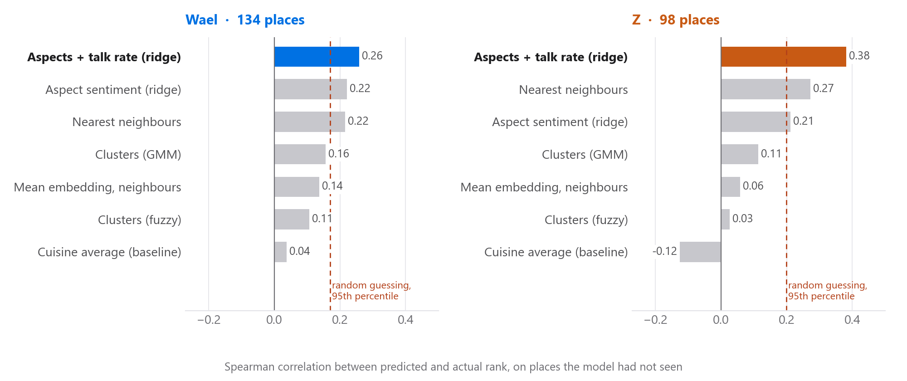
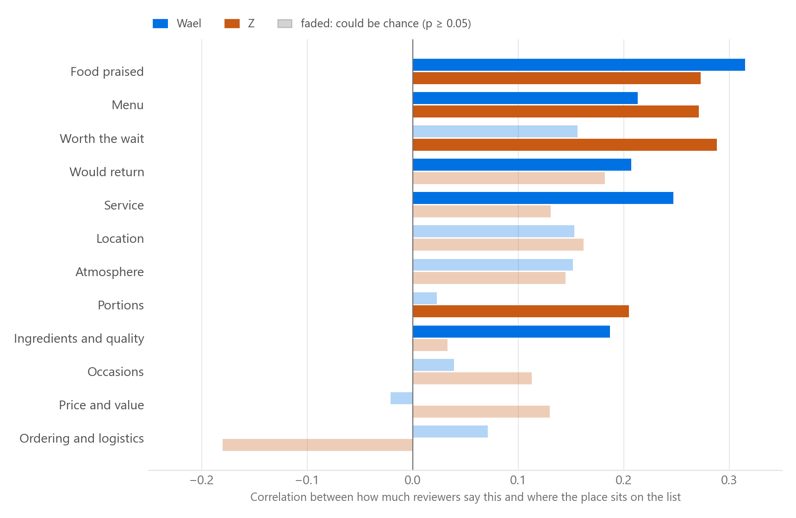
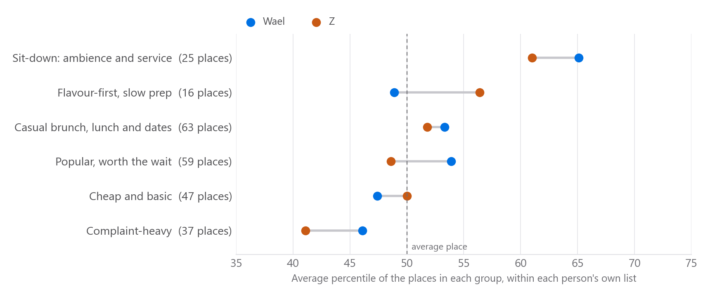
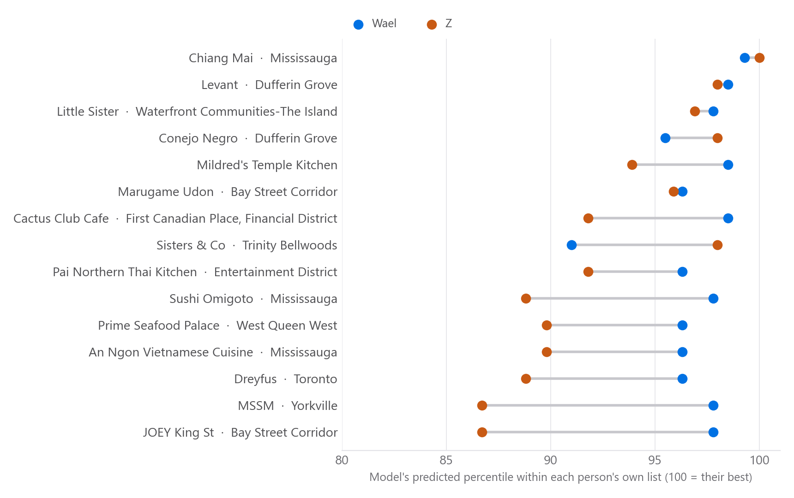

# taste-test

A restaurant taste model built from Beli rankings and Yelp review text. It learns what each person responds to in how reviewers describe a place (food, service, waits, portions and so on), predicts how they would rank places they have not been to, and combines several people's predictions into one list for picking somewhere together.

It works for any number of people. Two friends' Toronto lists (Wael and Z) are the test case.

**[Open the interactive app](https://wael6954.github.io/taste-test/)**: picks, taste charts and the 3D views, in your browser with nothing to download. To review the project stage by stage, read [`PIPELINE.md`](PIPELINE.md) (or the app's Pipeline tab).

## What it found

Ranking places the model has not seen (5-fold, repeated 5 times; Spearman correlation between predicted and actual rank):



- The winning model passes a permutation test (200 shuffles, p < 0.01 for both).
- How much reviewers praise the **food** is the strongest single signal for both (ρ ≈ 0.3, holds within cuisine). Beyond that, Wael tracks **service** and Z tracks **places people say are worth the wait**.



- Cuisine alone predicts nothing. Clusters describe taste but do not predict it on their own.



- New restaurants are scored through a frozen topic model. Their predicted scores barely correlate with Yelp stars, so the picks are not just the crowd favourites.



## Layout

```
index.html        redirects to app/ so GitHub Pages opens the app
app/              the web app (single HTML file)
PIPELINE.md       stage-by-stage review guide: inputs, outputs, checks, decisions, open questions
pipeline/         all code; see pipeline/README.md for the run order
  browser/        JavaScript run in a yelp.ca tab: matching, review pulls, GPU embeddings, new places
  lists/          cleaning the OCR'd Beli lists and scoring Yelp matches
results/          shareable outputs grouped by question (validation, taste, topics, recommendations, new places)
docs/             methodology, decisions log, opinion-unit test, img/ (README figures from pipeline/make_figures.py)
```

## Running it

```bash
pip install -r requirements.txt
# 1. browser stage: see pipeline/browser/README.md (produces pipeline/data/)
# 2. Python stage, then pages and app (BELI_DATA points at the raw inputs; defaults to pipeline/data):
BELI_DATA=~/Documents/beli-taste-data bash pipeline/run_all.sh
```

The browser stage needs a WebGPU browser (Chrome or Edge) and a visible yelp.ca tab.

## Data and privacy

The raw inputs (`BELI_DATA`, or `pipeline/data/`), `pipeline/out/` and `pipeline/topic_model_v4/` are kept out of git. They hold personal ratings and Yelp review text, which is not redistributed here. `results/` and `app/index.html` contain only aggregates, restaurant names and percentiles; review sentences are stripped at build time.

## Caveats

- Mostly 5-star reviews were pulled, so complaints are thin (11% of sentences are negative).
- Reviews come from Yelp only. New places have 20 reviews each against about 30 for rated ones, so their scores are noisier.
- The model was chosen after comparing seven methods on the same data. The permutation test guards against that, but more people and lists are the real test.

More in [`docs/methodology.md`](docs/methodology.md) and [`docs/decisions.md`](docs/decisions.md).
